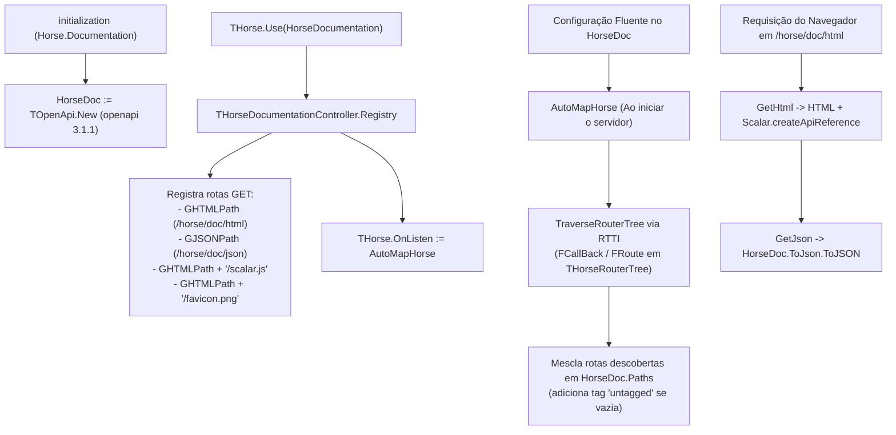

# Arquitetura e Funcionamento Interno

Este documento descreve a arquitetura interna do **Horse Documentation**, detalhando o ciclo de vida do middleware, a descoberta automática de rotas via RTTI, o carregamento de recursos embarcados e o mecanismo de coleções genéricas fluentes.

---

## Visão Geral do Fluxo

---

## 1. Inicialização e Registro do Middleware

Na seção `initialization` da unit `Horse.Documentation.pas`, a variável global `HorseDoc: IOpenApi` é instanciada automaticamente através da fábrica `TOpenApi.New`:

- `FOpenapi` é inicializado com `'3.1.1'`.
- `FInfo` é inicializado com título padrão `'Horse Documentation'` e versão `'1.0.0'`.

Quando a aplicação chama `THorse.Use(HorseDocumentation)` (ou a sobrecarga com caminhos customizados), o método `THorseDocumentationController.Registry` executa duas ações:

1. **Registra 4 endpoints `GET` na instância do Horse**:
   - `GHTMLPath` (padrão `/horse/doc/html`): serve a página HTML principal que inicializa o componente `Scalar.createApiReference`.
   - `GJSONPath` (padrão `/horse/doc/json`): serializa `HorseDoc.ToJson.ToJSON` com `Content-Type: application/json`.
   - `GHTMLPath + '/scalar.js'`: entrega o bundle JavaScript do Scalar extraído do recurso compilado.
   - `GHTMLPath + '/favicon.png'`: entrega o logotipo PNG do Horse extraído do recurso compilado.
2. **Associa `THorse.OnListen := AutoMapHorse`**: garantindo que, quando o servidor entrar em escuta, todas as rotas registradas sejam mapeadas.

---

## 2. Descoberta Automática de Rotas via RTTI (`AutoMapHorse`)

O Horse armazena suas rotas internamente em uma estrutura de árvore prefixada (`THorseRouterTree`), cujos campos `FCallBack` e `FRoute` são privados.

Para descobrir todas as rotas sem exigir alterações no código-fonte do Horse, o método `THorseDocumentationController.TraverseRouterTree` utiliza `System.Rtti`:

1. **Inspeção de `FCallBack`**:
   - Acessa `TObjectDictionary<TMethodType, TList<THorseCallback>>` do nó atual da árvore;
   - Para cada verbo HTTP (`TMethodType`) registrado naquele caminho, adiciona um registro `TRouteInfo(Method, Path)`.
2. **Inspeção Recursiva de `FRoute`**:
   - Acessa `TDictionary<string, THorseRouterTree>` contendo os segmentos filhos da rota;
   - Se o segmento começar com `:` (padrão de parâmetro de rota do Horse, como `:id`), converte-o automaticamente para `{id}` (padrão de *path template* da especificação OpenAPI);
   - Concatena o segmento ao caminho acumulado e invoca `TraverseRouterTree` recursivamente.
3. **Mesclagem Não-Destrutiva em `AutoMapHorse`**:
   - Ignora qualquer rota cujo caminho inicie com `/horse/doc/`;
   - Chama `HorseDoc.Paths.Add(LRoute.Path)`. Como `Paths` é um `TOpenApiMap`, se o caminho já tiver sido configurado manualmente pelo desenvolvedor, a instância existente de `IPathItem` é reutilizada sem perder nenhuma informação;
   - Obtém a operação correspondente ao verbo HTTP (`Get`, `Put`, `Post`, `Head`, `Delete`, `Patch`);
   - Se `LOperation.Tags.IsEmpty` for verdadeiro, adiciona a tag padrão `'untagged'`.

---

## 3. Recursos Embarcados e Resolução de Caminhos Relativos

O arquivo `src/Horse.Documentation.res` (vinculado via `{$R Horse.Documentation.res}` em `Horse.Documentation.Controller.pas`) contém dois recursos do tipo `RT_RCDATA`:

- **`SCALAR_JS`**: bundle completo do Scalar API Reference (`application/javascript; charset=utf-8`);
- **`HORSE_ICON`**: ícone PNG do Horse (`image/png`).

O método `GetCurrentModuleHandle` utiliza `FindResourceHInstance(HInstance)` para localizar corretamente o módulo mesmo quando compilado dentro de pacotes BPL ou DLLs.

Além disso, `THorseDocumentationController.GetHtml` calcula caminhos relativos (`GetRelativePath`) para o `favicon.png`, `scalar.js` e para o endpoint JSON. Isso permite que a documentação funcione corretamente mesmo quando a API Horse está publicada atrás de um **proxy reverso** (Nginx, Apache, IIS, Traefik, API Gateway) com reescrita de prefixo de URL.

---

## 4. Coleções Genéricas Fluentes (`TOpenApiList` e `TOpenApiMap`)

Um dos pilares de design do **Horse Documentation** é permitir encadeamento fluente contínuo através de listas e dicionários sem quebrar a navegação de volta ao objeto pai (`.&End`).

Isso é implementado em `Horse.Documentation.OpenApi.Types.pas` por meio de duas classes genéricas:

### `TOpenApiList<T, O>` (herda de `TList<T>`)

Recebe dois parâmetros de tipo:
- `T`: tipo do item armazenado na lista (uma interface OpenAPI como `IServer<IOpenApi>` ou um tipo primitivo como `string`);
- `O`: tipo da interface "pai" (*Owner*), para a qual o fluxo retorna.

No construtor `Create(AOwner: O; AImplClass: TClass = nil)`:
- Se `AImplClass` for informado, a lista mantém um `TRttiContext` ativo (`KeepContext`) e localiza o método estático de fábrica `class function New(AOwner: O): T` na classe de implementação;
- Quando `.Add` (ou seus aliases `.Append` e `.Push`) é chamado sem parâmetros, ele invoca `FCreateMethod.Invoke(FImplClass, [TValue.From<O>(FOwner)])`, adiciona a nova interface à lista e a retorna para configuração fluente;
- Quando a sobrecarga `.Add(const AValue: T): O` é chamada (por exemplo, em listas de `string` como `Tags.Add('Clientes')`), ela adiciona o valor e retorna diretamente o `FOwner` (`O`).

### `TOpenApiMap<T, O>` (herda de `TDictionary<string, T>`)

Segue o mesmo princípio para mapas chave-valor:
- `.Add(const AKey: string): T`: verifica se `AKey` já existe no dicionário; se existir, retorna a instância existente (`Items[AKey]`). Caso contrário, invoca o método estático `New(FOwner)` via RTTI, registra a instância sob `AKey` e a retorna;
- `.AddValue(const AKey: string; const AValue: T): O`: usado para mapas de valores diretos (como `Components.Schemas`, `Link.Parameters`, `OAuthFlow.Scopes` e `Extensions`), inserindo o par chave/valor e retornando o `FOwner` (`O`).

---

## 5. Pipeline de Serialização JSON

Todos os modelos de objetos da especificação herdam de `TOpenApiAncestor`:

1. `TOpenApiAncestor.ToJson` cria a instância de `TJSONObject` e serializa automaticamente quaisquer entradas presentes em `FExtensions` (`x-*`).
2. Cada subclasse chama `Result := inherited ToJson;` e adiciona apenas os campos preenchidos (omitindo strings vazias, coleções vazias e referências `nil`, além de omitir valores padrão de `style` e `explode` em `TParameter` e `THeader` conforme a especificação OpenAPI 3.1.1).
3. Coleções `TOpenApiList` e `TOpenApiMap` serializam elementos que implementam `IOpenApiAncestor` chamando `.ToJson`, e elementos primitivos/complexos chamando `TUtils.ValueToJson`.
